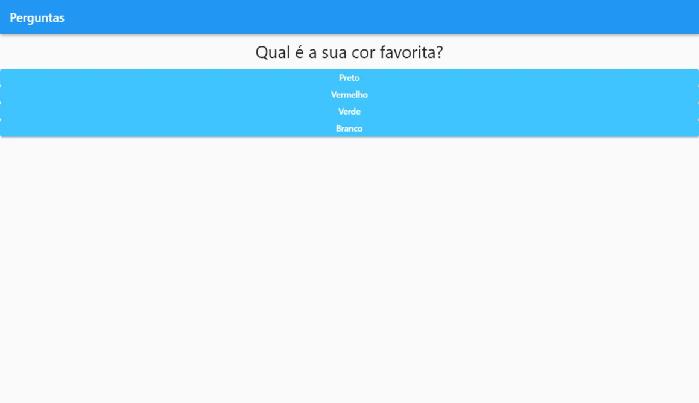
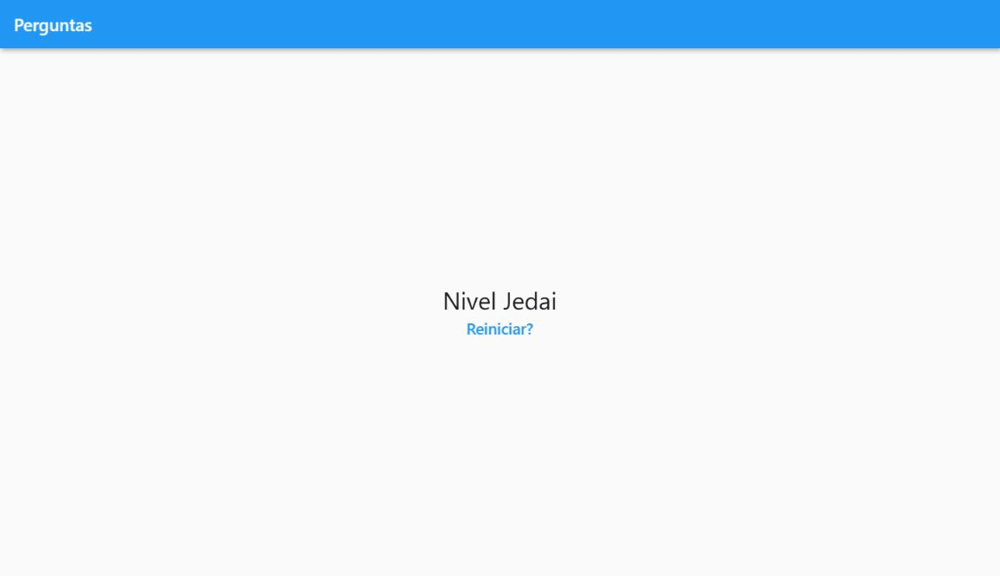

# Quiz de Preferências em Flutter

Aplicativo de estudo que apresenta três perguntas sobre preferências pessoais, soma os pontos das alternativas escolhidas e mostra uma mensagem de resultado. É um exercício de navegação entre estados e composição de widgets em Flutter.

**Categoria:** Frontend · Aplicativo móvel · Estudo.

## Tecnologias principais

- Dart 2
- Flutter

## O que o quiz pergunta

As perguntas presentes no código são:

1. Qual é sua cor favorita?
2. Qual é seu animal favorito?
3. Qual é seu instrutor favorito?

Cada alternativa tem uma pontuação definida no aplicativo. Ao terminar, a soma escolhe uma mensagem, como “Nivel Jedai”. O resultado representa a regra do exemplo; não mede conhecimento nem faz uma avaliação psicológica.

## Funcionalidades

- Exibir uma pergunta por vez com suas alternativas.
- Avançar ao selecionar uma resposta e acumular pontos.
- Trocar o questionário pela tela de resultado.
- Reiniciar o quiz e limpar o estado anterior.

## Organização

A implementação está em `lib/`, com a tela principal e os widgets de pergunta, resposta, questionário e resultado. As perguntas são dados locais: não há banco de dados, autenticação ou API externa.

## Executar

Use um ambiente Flutter com Dart 2, compatível com a restrição `>=2.7.0 <3.0.0` do projeto. Na pasta do repositório, com um dispositivo ou emulador configurado:

```bash
flutter pub get
flutter run --no-sound-null-safety
```

O código antecede a migração para null safety. Flutter com Dart 3 exige atualização do projeto.

## Execução das capturas

A interface foi compilada com Flutter 2.10.5 e Dart 2.16.2. Um destino web foi gerado somente na cópia local para abrir o aplicativo no navegador. O questionário completo e a tela de resultado foram executados; as imagens mostram os widgets do projeto original.

## Relação com outros projetos

Aplicativo independente. Os demais projetos Flutter desta coleção são exemplos separados e não fornecem um backend para este quiz.

## Capturas do sistema

Capturas reais obtidas em execução local em 12/10/2026.

### Página inicial



### Resultado após responder às perguntas



## Histórico

Repositório criado no GitHub em **2021-03-11**. Essa data identifica a criação do repositório; não comprova o início nem a conclusão do desenvolvimento.
